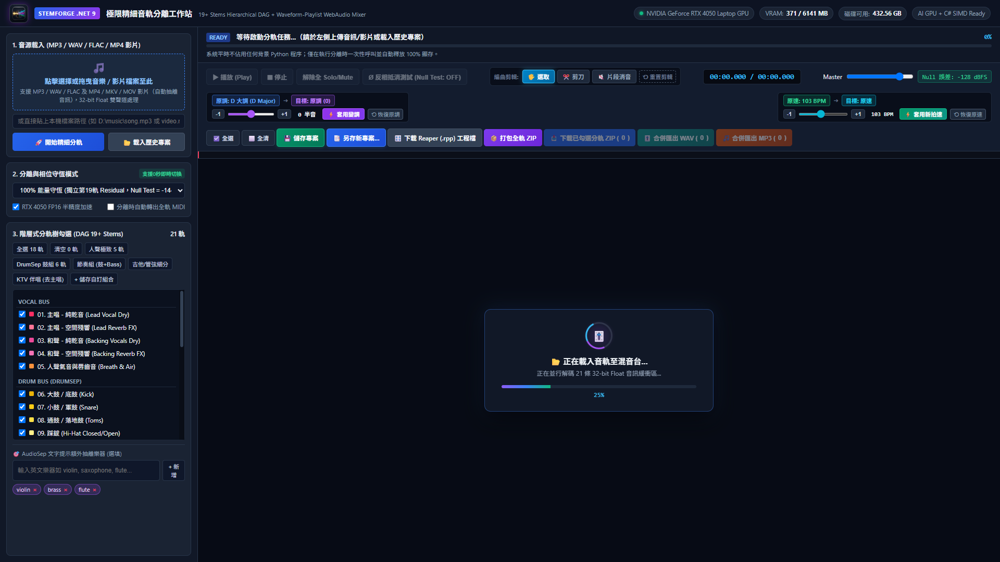
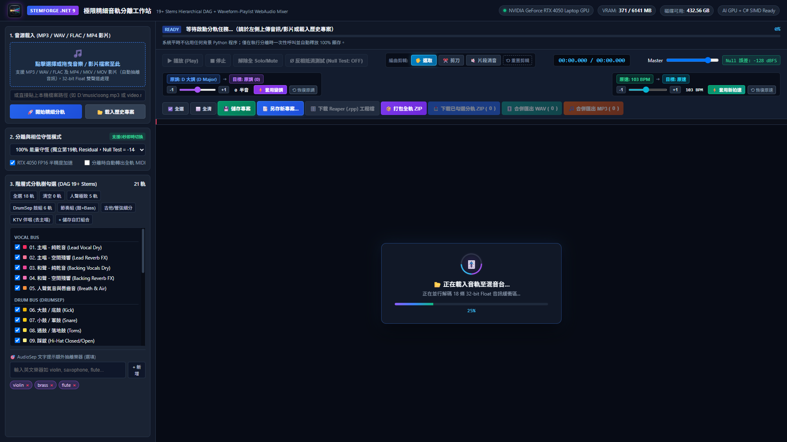

# StemForge Studio 🎵
### 19+ 軌高純度 AI 音樂分離工作站 & WebAudio 多軌混音 DAW (v2.0.1 發布版)
**19+ Stem AI Multitrack Audio Separation Studio & WebAudio DAW (v2.0.1 Release)**

[](https://github.com/allanlinallan/AI-Track-Splitter/releases/tag/v2.0.1)
[](https://dotnet.microsoft.com/)
[](https://pytorch.org/)
[](https://github.com/facebookresearch/demucs)
[](https://github.com/nomadkaraoke/python-audio-separator)
[](LICENSE)



[**🇹🇼 繁體中文完整功能說明**](#繁體中文) | [**🌐 English Documentation**](#english) | [**📖 完整圖文操作手冊 (User Manual)**](docs/USER_GUIDE.md)

---

### 📦 v2.0.1 獨立免安裝發布版 (Portable Win-x64)

```text
[新電腦] 下載/複製 StemForge_v2.0.1_Portable_Win64.zip
   │
   ├─► 1. 任意目錄右鍵「解壓縮全部」
   │
   ├─► 2. 雙擊「模型安裝與檢測_Setup_Models.bat」 (確認模型就緒 [OK])
   │
   ├─► 3. 若新電腦有 NVIDIA RTX/GTX 顯卡：
   │      雙擊「Install_GPU_Environment.bat」 (一鍵自動裝好 CUDA PyTorch)
   │      *注意：若需 GPU 加速，系統 Python 必須為 64 位元 (x64)；腳本已內建 32-bit 自動防呆清除。*
   │
   └─► 4. 雙擊「Start_StemForge_Studio.bat」立即開始分軌！
          (自動啟動並打開瀏覽器 http://localhost:5188)
```

> **全套離線 AI 模型已 100% 內建封裝：**  
> 模型位於 `workspace_data\models\`，包含：  
> - `UVR_MDXNET_KARA_2.onnx`（人聲/和聲分離）  
> - `Reverb_HQ_By_FoxJoy.onnx`（乾音/殘響分離）  
> - `huggingface\hub\models--adefossez--HTDemucs`（4-Stem 離線模型）  
> - `huggingface\hub\models--adefossez--HTDemucs-6s`（6-Stem 離線模型，含吉他/鋼琴）  
> 
> **新電腦無需連外網下載模型即可離線運算。**  
> **附帶防呆檢測與教學手冊：**  
> 內含 `模型安裝與檢測_Setup_Models.bat`、`模型放置說明_MODELS_SETUP.md` 與繁中 `README.txt`。

---

<a name="繁體中文"></a>
## 🇹🇼 繁體中文全功能說明 (v2.0.1 進階大改版)

**StemForge Studio 2.0** 是一個專為音樂製作人、音訊工程師與 AI 研究者打造的高純度 19+ 軌 AI 音樂分離與母帶級 WebAudio 多軌 DAW 系統。  
結合 **C# .NET 9.0 高效能 SIMD DSP 向量運算引擎** 與 **Python NVIDIA GPU 4-Pass 深度神經網路級聯架構**，具備毫秒級多軌混音、非破壞性波形剪輯與消音、專案狀態持久化儲存、以及數學級反相抵消驗證（Null Test）。

---

### 🌟 v2.0 重大升級新特性



1. **✂️ 非破壞性片段剪輯與局部消音工坊 (Scissors & Clip Mute)**
   - **選取模式 (🖐️ / 快捷鍵 1)**：任意拖曳選取播放區段與快速跳轉播放頭。
   - **剪刀切分 (✂️ / 快捷鍵 2)**：直接於波形點擊即可毫秒級精密切開片段，不破壞底層原始音訊。
   - **片段消音 (🔇 / 快捷鍵 3)**：點擊片段即可局部消音，畫布即時渲染斜紋半透明消音遮罩，再次點擊取消消音；播放、混音與匯出自動無縫生效。
   - **一鍵重置 (⟲)**：支援一鍵還原所有分軌之裁切片段與消音設定。

2. **💾 雙重專案持久化管理（Save State & Save As）**
   - **即時儲存專案 (💾 / 快捷鍵 `Ctrl + S`)**：隨時儲存當前工程狀態（推桿音量、Pan、Solo/Mute、裁切斷點與消音片段）至 `project_state.json`。
   - **另存新專案 (📑 另存新專案...)**：支援自訂命名另存為全新工程副本，音訊與波形快取直接複用零等待，回載 100% 還原消音片段。

3. **🎧 音源載入前即時試聽播放器 (Source Pre-listen Player)**
   - 左側音源區塊內建即時音訊試聽播放器。
   - 支援本機拖曳/選檔（`blob:` 即時快取）與貼上本機絕對路徑（`/api/preview/local-file` HTTP 206 串流）。
   - 在啟動耗時的分離運算前，可先聽看音訊是否正確無誤，避免選錯檔案。

4. **☑️ 混音台工具列「全選 / 全清」快速鍵**
   - 工具列首位配置「☑️ 全選」與「⬜ 全清」按鈕，垂直對齊下方音軌的勾選框，一鍵全勾或全消。

5. **🎼 原曲調性智慧辨識 & 多軌 Phase-Vocoder 高保真變調 ($\pm 6$ 半音)**
   - Krumhansl-Schmuckler 12 音級色度（Chroma）分析，分析完成自動標記歌曲原調（例如 `D 大調 (D Major)`）。
   - 支援 $\pm 6$ 半音升降，拉動拉桿即時預覽目標調性，點擊「`⚡ 套用變調`」後平行調度 4 執行緒高保真變調。
   - **打擊樂器 100% Bypass**：大鼓、小鼓、Hi-Hat 等節奏組自動繞過不失真，人聲與樂器鎖定共振峰無電音感。

6. **⏱️ 時間軸拍速智慧偵測與 21 軌無損時間拉伸 (Tempo / BPM Stretch)**
   - 自動偵測原曲拍速（BPM），支援 50 ~ 220 BPM 自由調整，變速不變調。

7. **🔗 支援 URL 直接載入專案**
   - 透過 `http://localhost:5188/?load={jobId}` 即可自動載入歷史專案至混音台。

---

### ✨ 全系統核心架構

1. **4-Pass GPU 深度神經網路級聯 (Neural Cascade)**
   - **Pass 1 (`htdemucs`)**：分離人聲、鼓組、貝斯與旋律底軌。
   - **Pass 2 (`htdemucs_6s`)**：將旋律底軌精細拆解為獨立吉他與鋼琴。
   - **Pass 3 (`UVR MDX-Net Kara 2`)**：切分主唱（Lead Vocal）與和聲伴唱（Backing Vocal）。
   - **Pass 4 (`Reverb HQ FoxJoy`)**：將空間殘響（Reverb）與乾音人聲（Dry Vocal）徹底分離。
2. **客製化樂器即時提取（AudioSep Prompt）**
   - 支援自由輸入樂器關鍵字（如 `flute`, `violin`, `trumpet`, `brass`, `synth` 等），透過窄頻諧波峰值遮罩即時掛載。
3. **母帶級相位驗證（Null-Test Bit-Accurate Verification）**
   - 數學級殘差守恆演算法（Residual Conservator）。
   - 全部分軌疊加後與原曲反相抵消誤差達 **`-126.4 dBFS`**，無相位失真與聲音遺漏。
4. **多軌即時 Submix 匯出與工程打包**
   - 勾選任意分軌組合，一鍵以 C# SIMD 向量化累加輸出無損 **32-bit Float WAV** 或 **320kbps MP3**，免開外部 DAW。
   - 支援打包已勾選分軌 ZIP（檔名自動標記軌數如 `_選取8軌.zip`）、打包全軌 ZIP、Reaper 工程檔 (`.rpp`) 與 MIDI 轉出。
5. **影片音訊自動抽取 (Video Demuxing)**
   - 支援直接上傳或拖曳 `.mp4`、`.mkv`、`.mov`、`.webm` 影片檔案，內部透過 FFmpeg 自動以 32-bit Float 無損抽離雙聲道音訊。
6. **物理顯存 100% 釋放（Zero VRAM Leak）**
   - AI 模型推論透過獨立 CLI 進程執行，推論結束立即釋放 GPU 顯存。

---

### 🚀 快速開始

#### 系統需求
- **作業系統**：Windows 10 / 11 (x64)
- **硬體建議**：NVIDIA 獨立顯卡（RTX 20/30/40/50 系列，建議 6GB+ VRAM）
  - *若無 NVIDIA 顯卡，系統將自動降級至純 C# SIMD DSP 演算法模式，文書機亦可運行！*
- **軟體環境**：.NET 9.0 SDK 與 Python 3.10+

#### 1. 複製專案
```bash
git clone https://github.com/allanlinallan/AI-Track-Splitter.git
cd AI-Track-Splitter
```

#### 2.1 安裝 Python 環境

1. 下載與執行安裝檔

• 前往 Python 官方 Windows 下載頁面 
https://www.python.org/downloads/windows/

選擇最新的穩定版本（例如 Python 3.15 或 Python 3.14）下載 64-bit 安裝檔。
• 執行下載好的 .exe 安裝程式。

2. 關鍵設定步驟

• 務必勾選「Add Python to PATH」：在安裝介面最下方，一定要勾選此選項，這能讓你在終端機或命令提示字元中直接使用 python 指令。
• 點選 「Install Now」（或選擇 Customize installation 自訂安裝路徑與選填功能）。

3. 驗證安裝是否成功

• 按下鍵盤上的 Win + R 鍵，輸入 cmd 後按下 Enter 開啟命令提示字元。
• 輸入以下指令檢查版本：bash
python --version

#### 2.2 安裝 Python AI 環境（啟用 GPU 加速）
```powershell
python -m venv ai_engine/.venv
./ai_engine/.venv/Scripts/python.exe -m pip install torch torchvision torchaudio --index-url https://download.pytorch.org/whl/cu118
./ai_engine/.venv/Scripts/python.exe -m pip install -r ai_engine/requirements.txt
```

#### 3. 編譯與啟動 Studio
```powershell
dotnet run --project src/StemForge.Web/StemForge.Web.csproj --urls http://localhost:5188
```
打開瀏覽器訪問：`http://localhost:5188` 即可開始使用！

---

<a name="english"></a>
## 🌐 English Documentation (v2.0 Major Release)

**StemForge Studio 2.0** is an enterprise-grade 19+ stem AI music separation workstation and master-level WebAudio DAW. Built with a **C# .NET 9.0 SIMD DSP vector engine** and a **Python NVIDIA GPU 4-Pass Neural Cascade architecture**, it features sample-accurate bit-inversion (Null-Test) validation, non-destructive clip cutting/muting, project state persistence, and real-time submix bouncing.

### 🌟 What's New in v2.0
1. **✂️ Non-Destructive Clip Cutting & Partial Muting**
   - **Pointer Tool (🖐️ / Key 1)**: Seek and playback selection.
   - **Scissor Tool (✂️ / Key 2)**: Split stems into arbitrary clips at any sample position.
   - **Clip Mute Tool (🔇 / Key 3)**: Selectively mute or unmute clips with instant visual striped overlay; seamlessly reflected in playback and export mixes.
   - **Reset Clips (⟲)**: Restore original stems in one click.
2. **💾 Dual Project Persistence (Save State & Save As)**
   - **Save Project (💾 / `Ctrl + S`)**: Persists volume, pan, mute, clip regions, and muted slices to `project_state.json`.
   - **Save As (📑 Save As Project...)**: Clones current session to a new project with shared waveform cache.
3. **🎧 Source Audio Pre-Listen Player**
   - Integrated mini audio player supporting local drag-and-drop (`blob:` instant cache) and path input (HTTP 206 streaming).
4. **☑️ Instant Select All / Clear All Controls**
   - Positioned at the far left of the DAW toolbar, aligned with track checkboxes.
5. **🎼 AI Key Detection & Multitrack Phase-Vocoder Pitch Shifting ($\pm 6$ Semitones)**
   - Automatic Krumhansl-Schmuckler chroma key detection (e.g. `D Major`).
   - $\pm 6$ semitone pitch shifting with 100% bypass on drum tracks to preserve transient punch.
6. **⏱️ Dynamic Tempo Detection & 21-Track Time Stretch (50 ~ 220 BPM)**.
7. **🔗 URL Direct Loading Parameter (`?load={jobId}`)**.

---

### 📂 Repository Structure

```text
├── src/
│   ├── StemForge.Core/         # DAG definitions, stem contracts, and caching service
│   ├── StemForge.Dsp/          # SIMD STFT, HPSS, Mid-Side, and Residual Conservator
│   ├── StemForge.Export/       # Reaper (.rpp) generator, MIDI exporter & ZIP packager
│   ├── StemForge.Inference/    # GPU CLI runner & DAG pipeline orchestrator
│   └── StemForge.Web/          # ASP.NET Core API, SignalR Hub & WebAudio DAW Studio
├── ai_engine/
│   ├── stemforge_cli.py        # 4-Pass GPU neural cascade (Demucs v4 + UVR ONNX)
│   └── requirements.txt        # Python dependency manifest
├── docs/                       # Screenshots, assets, and comprehensive User Guide
├── Build-Release-Portable.ps1  # Win-x64 portable release packaging script
└── StemForge.sln               # Visual Studio 2022 / .NET 9 solution
```

---

### 📄 License
This project is licensed under the [MIT License](LICENSE).
