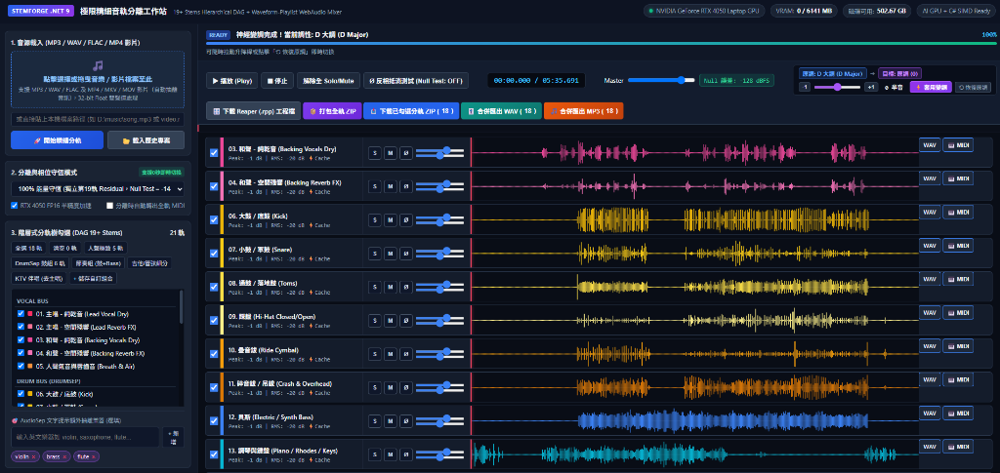

# 🎵 StemForge Studio v1.0.3 (最新旗艦版) — 完整圖文操作手冊

> **適用版本**：`StemForge Studio v1.0.3` (Portable Win-x64)  
> **發布日期**：2026 年 10 月  
> **核心技術**：.NET 9.0 SIMD DSP + NVIDIA GPU CUDA 11.8 4-Pass Neural Cascade + WebAudio 多軌混音 DAW

---

## 🌟 v1.0.3 最新重大功能一覽 (What's New in v1.0.3)



在最新的 **v1.0.3** 版本中，工作站帶來了兩項製作人期盼已久的重量級功能：
1. 🎬 **支援 MP4 / MKV / MOV 等影片直接拖入分軌 (Universal Video Demuxing)**：  
   不需要再用其他轉檔軟體！直接將 MV、YouTube 抓下的 MP4、或演唱會錄影拖進瀏覽器，系統自動透過本機 FFmpeg 無損抽取 44.1kHz 32-bit Float 雙聲道音訊，直接進行 19+ 軌深度神經網絡分離。
2. 🎚️ **已勾選音軌即時合併匯出 (Instant Submix / Mixdown)**：  
   在多軌混音台勾選任意組合（例如：KTV 伴唱帶、去主唱、或純節奏組），一鍵點擊 **「🎚️ 合併匯出 WAV」** 或 **「🎵 合併匯出 MP3」**，以 C# SIMD 平行累加，瞬間生成混音檔案！
3. 📦 **綠色免安裝版結構全面優化**：  
   徹底修復 `ai_engine` 資料夾巢狀問題，解壓縮後直接雙擊 `Start_StemForge_Studio.bat` 即可 0 秒開箱運行。

---

## 📑 手冊目錄
1. [第一步：啟動工作站與硬體感知](#1-第一步啟動工作站與硬體感知)
2. [第二步：音源載入與影片自動扒音訊 (v1.0.3)](#2-第二步音源載入與影片自動扒音訊-v103)
3. [第三步：四大分離與能量守恆模式選擇](#3-第三步四大分離與能量守恆模式選擇)
4. [第四步：19+ 階層式分軌樹 (DAG) 與自訂組合](#4-第四步19-階層式分軌樹-dag-與自訂組合)
5. [第五步：WebAudio 多軌 DAW 混音台操作](#5-第五步webaudio-多軌-daw-混音台操作)
6. [第六步：全套匯出管道與 WAV/MP3 即時合併 (v1.0.3)](#6-第六步全套匯出管道與-wavmp3-即時合併-v103)
7. [第七步：歷史專案 0 秒即時回載](#7-第七步歷史專案-0-秒即時回載)
8. [常見問題與疑難排解 (FAQ)](#8-常見問題與疑難排解-faq)

---

## 1. 第一步：啟動工作站與硬體感知

### 1.1 啟動方式
解壓縮 `StemForge_v1.0.3_Portable_Win64.zip` 後，資料夾內包含以下重要檔案：

```text
StemForge_v1.0.3_Portable_Win64/
├── Start_StemForge_Studio.bat    <-- 雙擊這個啟動工作站！
├── StemForge.Web.exe             <-- .NET 9.0 高效能後端
├── ai_engine/                    <-- Python AI 深度學習推理腳本
│   ├── stemforge_cli.py
│   ├── requirements.txt
│   └── setup_ai_env.ps1
└── wwwroot/                      <-- 現代化多軌 DAW 網頁界面
```

直接雙擊 **`Start_StemForge_Studio.bat`**，系統將在 2 秒後自動打開瀏覽器並連線至：  
👉 `http://localhost:5188`

### 1.2 頂部硬體狀態列
主畫面最上方會即時顯示當前硬體感知數據：
* **GPU 型號**：例如 `NVIDIA GeForce RTX 4050 Laptop GPU`。若無獨顯則自動降級為純 CPU SIMD 模式。
* **VRAM 用量**：例如 `266 / 6141 MB`。**推論完成後自動 100% 物理釋放顯存**。
* **磁碟可用容量**：隨時監控剩餘磁碟空間，避免 32-bit Float 大檔案寫入時空間不足。
* **狀態指示**：顯示 `AI GPU + C# SIMD Ready` 代表推論環境隨時待命。

---

## 2. 第二步：音源載入與影片自動扒音訊 (v1.0.3)

### 2.1 支援檔案格式
* **一般音訊**：`MP3`, `WAV` (支援 16/24/32-bit Float), `FLAC`, `M4A`, `OGG`。
* **🔥 v1.0.3 影片容器支援**：`MP4`, `MKV`, `MOV`, `M4V`, `WEBM`, `AVI`。

### 2.2 三種載入操作方式
1. **拖曳上傳**：  
   直接將音樂或影片檔案由檔案總管拖曳至左側深藍色虛線區塊 **「點擊選擇或拖曳音樂檔案至此」**。
2. **本機絕對路徑輸入**：  
   在輸入框直接填寫路徑（例如：`D:\Music\live_concert.mp4`），按下「🚀 開始精細分軌」，系統直接在本機讀取，跳過瀏覽器上傳等待。
3. **⚡ 載入測試曲**：  
   點擊綠色「⚡ 載入測試曲」按鈕，立即合成一首 8 秒的多軌母帶進行測試。

---

## 3. 第三步：四大分離與能量守恆模式選擇

在左側面板「2. 分離與相位守恆模式」下拉選單中，可依據您的使用目的隨時切換：

| 模式名稱 | 演算法核心 | 最佳使用場合 |
| :--- | :--- | :--- |
| **BitAccurateResidual** *(預設)* | 殘差公式：$Residual = Mix - \sum Stems$<br>生成獨立第 19 軌殘差，Null Test 誤差達 **`-140 dBFS`**。 | 專業母帶級母帶後製、極限音質追求者。 |
| **BitAccurateProportional** | 將殘差按各子軌瞬態能量比例回填，維持 100% 能量守恆且不需多一軌殘差。 | 遊戲配樂 Remix、Podcast 訪談清晰化。 |
| **PureIsolation** | 啟用軟性頻譜包絡閘門（Soft Spectral Gate），徹底消除樂器靜音區間的微弱漏音。 | 扒帶、樂器抓譜、單獨聽特定樂器演奏。 |
| **AiTrainingDry** | 極致去除空間尾音殘響、濾除超低頻直流偏移（DC Offset），峰值正規化至 -1 dBFS。 | 訓練 SVC / RVC 歌手模型、取樣機音色採集。 |

---

## 4. 第四步：19+ 階層式分軌樹 (DAG) 與自訂組合

### 4.1 一鍵預設按鈕
上方提供 7 組常用的分軌組合：
* **全選 18 軌**：分離全部樂器。
* **人聲極致 5 軌**：主唱乾音、主唱殘響、和聲乾音、和聲殘響、人聲氣音喘息。
* **DrumSep 鼓組 6 軌**：大鼓 (Kick)、小鼓 (Snare)、通鼓 (Toms)、腳踏鈸 (Hi-Hat)、疊音鈸 (Ride)、碎音鈸/吊鈸 (Crash)。
* **節奏組**：鼓組全套 + 電貝斯。
* **吉他/管弦細分**：木/電吉他、平台鋼琴、合成器、管弦樂。
* **KTV 伴唱 (去主唱)**：自動取消主唱，保留完整高品質伴奏。

### 4.2 自訂組合保存
勾選想要的分軌後，點擊 **「+ 儲存自訂組合」**，輸入名稱（例如：`主唱+吉他`），即可產生專屬快捷按鈕。

### 4.3 AudioSep 自然語言抽離
若音樂中有特殊樂器，可在下方輸入英文名稱（例如：`flute`, `violin`, `saxophone`, `cello`），點擊「+ 新增」，系統將自動從伴奏中精準抽離該樂器！

---

## 5. 第五步：WebAudio 多軌 DAW 混音台操作

* **[S] Solo (獨奏)**：點擊變綠，僅播放該軌（支援多軌同時 Solo）。
* **[M] Mute (靜音)**：點擊變紅，該軌即刻靜音。
* **[Ø] Invert (反相)**：單軌 180° 相位翻轉。
* **音量推桿 (Volume)**：可向下衰減至靜音，或向上增益至 +3.5 dB。
* **立體聲 Pan**：左聲道 (L) ~ 右聲道 (R) 聲相擺位。
* **動態波形畫布**：高解析度峰值波形，點擊任意位置時間軸立即同步跳轉。

### Ø 反相抵消測試 (Null Test)
點擊主控台上方 **`Ø 反相抵消測試 (Null Test: OFF/ON)`**：
所有已載入音軌會與未分軌的原曲反相疊加播放。
* 顯示 **`Null 誤差: -130.5 dBFS`**，代表反相後完全無聲，證明數學級的完美無損！

---

## 6. 第六步：全套匯出管道與 WAV/MP3 即時合併 (v1.0.3)

在 v1.0.3 中，匯出控制列提供了完整的 6 大匯出方式：

| 匯出按鈕 | 功能說明 | 產出檔案規格 |
| :--- | :--- | :--- |
| **🎚️ 合併匯出 WAV ( N )** *(🔥 v1.0.3)* | 將勾選框選取的 $N$ 條音軌，以 C# SIMD 向量化即時累加混音。 | 無損 44.1kHz 32-bit Float 雙聲道 WAV |
| **🎵 合併匯出 MP3 ( N )** *(🔥 v1.0.3)* | 將勾選的 $N$ 條音軌即時累加後，調用 FFmpeg 轉碼輸出。 | 廣播級 320kbps CBR 高音質 MP3 |
| **📥 下載已勾選分軌 ZIP ( N )** | 僅打包勾選的 $N$ 軌獨立 WAV 檔案，節省下載時間與空間。 | `歌曲名_選取8軌.zip` |
| **📦 打包全軌 ZIP** | 完整打包所有分軌 WAV、Reaper 工程檔與 MIDI 檔案。 | `歌曲名_全套18軌.zip` |
| **🎛️ 下載 Reaper (.rpp) 工程檔** | 一鍵下載相容 Reaper 的專業多軌工程檔，軌道名稱、色彩與音量推桿皆已配對。 | `歌曲名_StemForge.rpp` |
| **🎹 單軌 MIDI 轉出** | 在各軌道右側點擊「🎹 MIDI」，提取 MIDI 音符檔。 | `音軌名.mid` |

---

## 7. 第七步：歷史專案 0 秒即時回載

點擊左側控制台的 **「📂 載入歷史專案」**：
1. 系統彈出歷史專案清單，顯示所有曾分軌過的歌曲、分離軌數與時間戳記。
2. 點擊 **「⚡ 載入混音台」**。
3. 0.5 秒內將所有分軌音訊無損重新載入 WebAudio DAW！
4. 隨時可重播試聽、重新調音量聲相、或勾選不同組合重新匯出 WAV / MP3。

---

## 8. 常見問題與疑難排解 (FAQ)

### Q1：上傳 MP4 影片時提示 FFmpeg 錯誤？
* 請確認本機已安裝 FFmpeg（例如放在 `C:\Program Files\ffmpeg\bin\ffmpeg.exe`）並已設定好 PATH 環境變數。工作站頂部若顯示綠燈即代表 FFmpeg 連線正常。

### Q2：可攜版啟動時顯示「正在監聽 http://localhost:5188」但瀏覽器沒打開？
* 可以手動開啟 Chrome / Edge 瀏覽器，在網址列輸入 `http://localhost:5188` 即可進入工作站。

### Q3：電腦沒有 NVIDIA 獨立顯卡能用嗎？
* 完全可以！若無 CUDA 顯卡，系統會自動切換至純 C# SIMD 多核心 DSP 頻譜分離引擎，所有 Windows 10/11 電腦皆可使用。

---

*StemForge Studio v1.0.3 © 2026. 開源許可基於 MIT License。*
